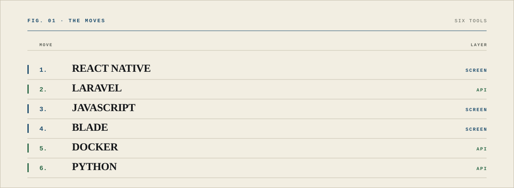
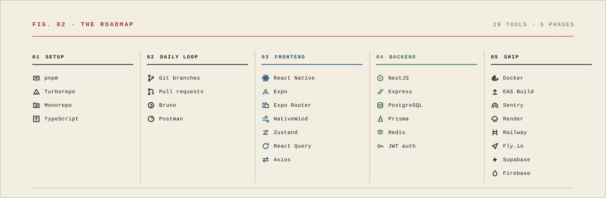
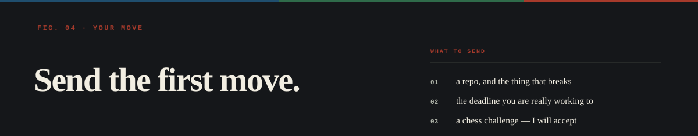

<!--
  ══════════════════════════════════════════════════════════════════════
  ALEKSIS A. ONG — GITHUB PROFILE README, SET LIKE A CHESS SCORE SHEET.
  Lives in the public repository named exactly aleksisong-ax/aleksisong-ax.

  WHY IT LOOKS LIKE THIS
  Paper and ink, then four pencil inks with one job each — red = the result,
  blue = the screen, green = the API, gold = the clock. Georgia for display and
  prose, mono for notation. No badges, no stats widgets, no emoji, no
  gradients — every figure is a local SVG in assets/, including the 29 stack
  marks (one 16px style, one ink each, drawn for this sheet)
  (regenerate with build_assets.py).

  THE ONE RULE
  Figures carry data; prose carries voice. No caption under a figure, no
  annotation, no footnote, no sign-off line. A section either has something to
  say, or it is cut.

  WHEN THINGS CHANGE
  · New name / handle → edit this file and assets/banner*.svg (or the NAME
    constant in build_assets.py, then rerun it).
  · Finished a better project → replace one of the two THE RECORD rows.
  · New stack → edit MOVES (what I use now) or PHASES (the roadmap) in
    build_assets.py; add a mark to GLYPHS if the tool doesn't have one yet.
  ══════════════════════════════════════════════════════════════════════
-->

<picture>
  <source media="(max-width: 600px)" srcset="assets/banner-mobile.svg">
  
</picture>

<table>
<tr>
<td width="20%" valign="top">
<samp>THE OPENING</samp>
</td>
<td width="80%" valign="top">

I'm **Aleksis**, a student at **Cavite State University**. I build with Laravel and PHP on the server, and with React Native when the thing needs to be in someone's pocket. Most of what's on this profile started as coursework — ITEC75A, DCIT26 — and turned into work I wanted to finish properly.

I'm steady when the brief changes. Hand me a stack I've never used and I'll come back with something that works; that's the part I actually enjoy.

</td>
</tr>
</table>

<picture>
  <source media="(max-width: 600px)" srcset="assets/moves-mobile.svg">
  
</picture>

<table>
<tr>
<td width="20%" valign="top">
<samp>THE ROADMAP</samp>
</td>
<td width="80%" valign="top">

**Laravel, PHP and Blade are what I ship with today.** The rest is the stack I'm building toward this year, one phase at a time.

</td>
</tr>
</table>

<picture>
  <source media="(max-width: 600px)" srcset="assets/roadmap-mobile.svg">
  
</picture>

<table>
<tr>
<td width="20%" rowspan="2" valign="top">
<samp>THE RECORD</samp>
</td>
<td width="6%" valign="top"><b>01</b></td>
<td width="46%" valign="top">
<b>Thornbury-care</b>
</td>
<td width="28%" valign="top">
LARAVEL · BLADE 
<a href="https://github.com/aleksisong-ax/Thornbury-care">Repository</a>
</td>
</tr>
<tr>
<td valign="top"><b>02</b></td>
<td valign="top">
<b>Customer-Service-Focused-Web-App</b>
</td>
<td valign="top">
HTML · JAVASCRIPT 
<a href="https://github.com/aleksisong-ax/Customer-Service--Focused-Web-App">Repository</a>
</td>
</tr>
</table>

<a href="https://github.com/aleksisong-ax?tab=repositories">ALL REPOSITORIES</a>

<picture>
  <source media="(max-width: 600px)" srcset="assets/grass-mobile.svg">
  
</picture>

<picture>
  <source media="(max-width: 600px)" srcset="assets/contact-mobile.svg">
  
</picture>

<table>
<tr>
<td width="20%" valign="top"><samp>EMAIL</samp></td>
<td width="80%" valign="top"><a href="mailto:aleksis.ong@github.com">aleksis.ong@github.com</a></td>
</tr>
<tr>
<td width="20%" valign="top"><samp>GITHUB</samp></td>
<td width="80%" valign="top"><a href="https://github.com/aleksisong-ax">/aleksisong-ax</a></td>
</tr>
<tr>
<td width="20%" valign="top"><samp>FACEBOOK</samp></td>
<td width="80%" valign="top"><a href="https://www.facebook.com/Aleksis.Ong">/Aleksis.Ong</a></td>
</tr>
</table>
