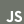
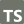
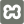
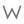

<!--
  Aleksis A. Ong — profile README.
  Lives in the public repository named exactly aleksisong-ax/aleksisong-ax.

  The page is text with a few pictures in it: the name plate, the board, and
  one small mark per technology in assets/logos/. Nothing is set as an image
  unless it is an image, so every word here can be selected, searched,
  translated and read aloud.

  Light and dark: every plate is emitted twice and swapped with <picture> +
  prefers-color-scheme, which GitHub supports. The stack marks are mid-tone so
  one file each is legible on either ground.

  The marks are open source: Simple Icons (CC0 1.0), recoloured and committed
  to assets/logos/ so nothing is hotlinked from a third-party CDN. The four
  without an open mark — generic SQL, React Native, WAMP, Java — are drawn in
  fetch_logos.py. Regenerate with build_assets.py and fetch_logos.py, both kept
  in the working copy, not in this repo.

  Keep the claims true. No stats, no streak counters, no badges, no copy that
  sounds like a pitch deck.
-->

<picture>
  <source media="(max-width: 600px) and (prefers-color-scheme: dark)" srcset="assets/banner-mobile-dark.svg">
  <source media="(max-width: 600px)" srcset="assets/banner-mobile.svg">
  <source media="(prefers-color-scheme: dark)" srcset="assets/banner-dark.svg">
  
</picture>

I'm **Aleksis**, a student at **Cavite State University**. I build with React and React Native on the screen, PHP and Java behind it, and I'm still collecting the rest. Most of what's here started as coursework — ITEC75A, DCIT26 — and turned into work I wanted to finish properly.

I'm steady when the brief changes: hand me a stack I've never used and I'll come back with something that works.

---

### What I build with

**Languages** —  JavaScript ·  TypeScript ·  Java ·  Python ·  PHP ·  Kotlin ·  SQL

**Frontend** —  React ·  React Native ·  Tailwind CSS

**Databases** —  MariaDB ·  MongoDB ·  phpMyAdmin

**Environment** —  XAMPP ·  WAMP ·  Vercel

### What I've built

**[Thornbury-care](https://github.com/aleksisong-ax/Thornbury-care)** — Laravel · Blade

**[Customer-Service-Focused-Web-App](https://github.com/aleksisong-ax/Customer-Service--Focused-Web-App)** — HTML · JavaScript

---

Away from the keyboard it's chess for the thinking, games for the unwind, and running for the part of the day nobody can reach me.

<picture>
  <source media="(max-width: 600px) and (prefers-color-scheme: dark)" srcset="assets/grass-mobile-dark.svg">
  <source media="(max-width: 600px)" srcset="assets/grass-mobile.svg">
  <source media="(prefers-color-scheme: dark)" srcset="assets/grass-dark.svg">
  
</picture>

---

**aleksis.ong@github.com** — the fastest way to reach me. Also on [GitHub](https://github.com/aleksisong-ax) and [Facebook](https://facebook.com/Aleksis.Ong).
