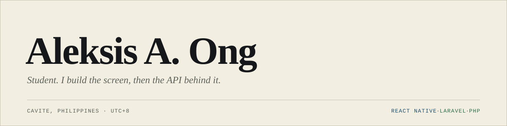
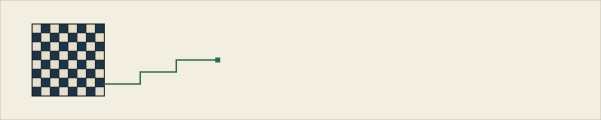

<!--
  Aleksis A. Ong — profile README.
  Lives in the public repository named exactly aleksisong-ax/aleksisong-ax.

  The page is text with two pictures in it: the name plate and the board,
  both local SVGs in assets/. Nothing is set as an image unless it is an
  image, so every word here can be selected, searched, translated and read
  aloud. Regenerate the figures with build_assets.py (kept in the working
  copy, not in this repo).

  Keep the claims true. No stats, no streak counters, no badges, no copy
  that sounds like a pitch deck.
-->

<picture>
  <source media="(max-width: 600px)" srcset="assets/banner-mobile.svg">
  
</picture>

I'm **Aleksis**, a student at **Cavite State University**. I build with Laravel and PHP on the server, and with React Native when the thing needs to be in someone's pocket. Most of what's here started as coursework — ITEC75A, DCIT26 — and turned into work I wanted to finish properly.

I'm steady when the brief changes: hand me a stack I've never used and I'll come back with something that works.

---

### What I build with

**Screen** — React Native · JavaScript · Blade

**API** — Laravel · PHP · Docker · Python

### What I've built

**[Thornbury-care](https://github.com/aleksisong-ax/Thornbury-care)** — Laravel · Blade

**[Customer-Service-Focused-Web-App](https://github.com/aleksisong-ax/Customer-Service--Focused-Web-App)** — HTML · JavaScript

---

Away from the keyboard it's chess for the thinking, games for the unwind, and running for the part of the day nobody can reach me.

<picture>
  <source media="(max-width: 600px)" srcset="assets/grass-mobile.svg">
  
</picture>

---

**aleksis.ong@github.com** — the fastest way to reach me. Also on [GitHub](https://github.com/aleksisong-ax) and [Facebook](https://facebook.com/Aleksis.Ong).
